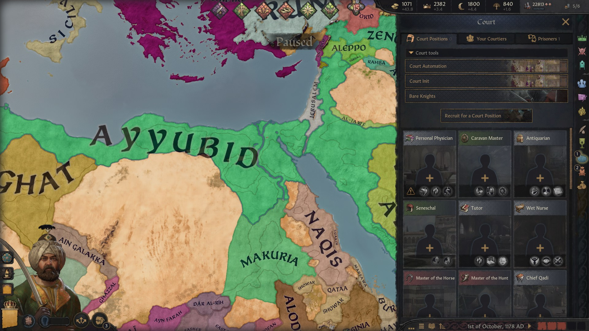
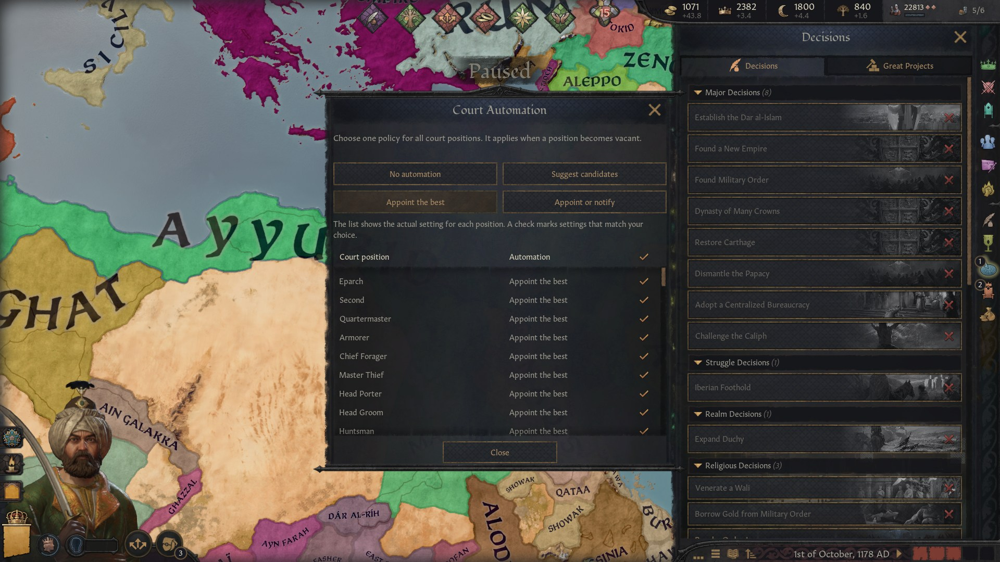
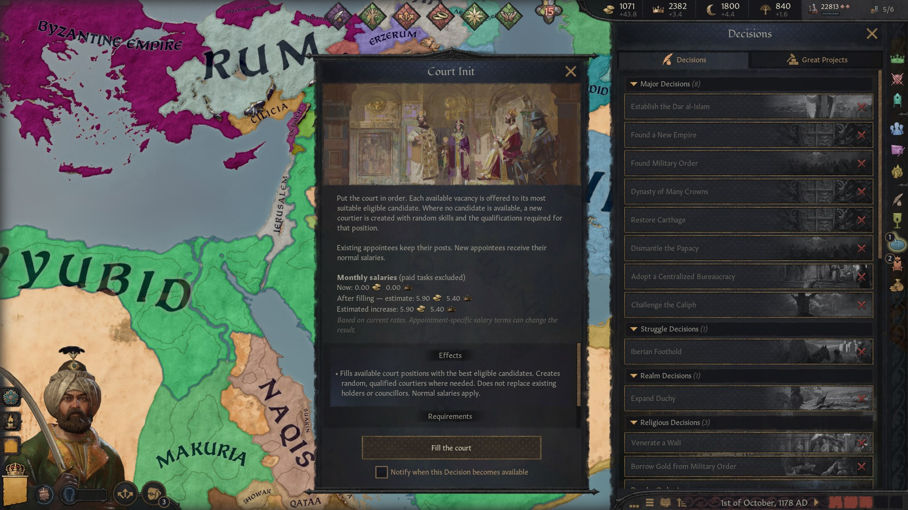
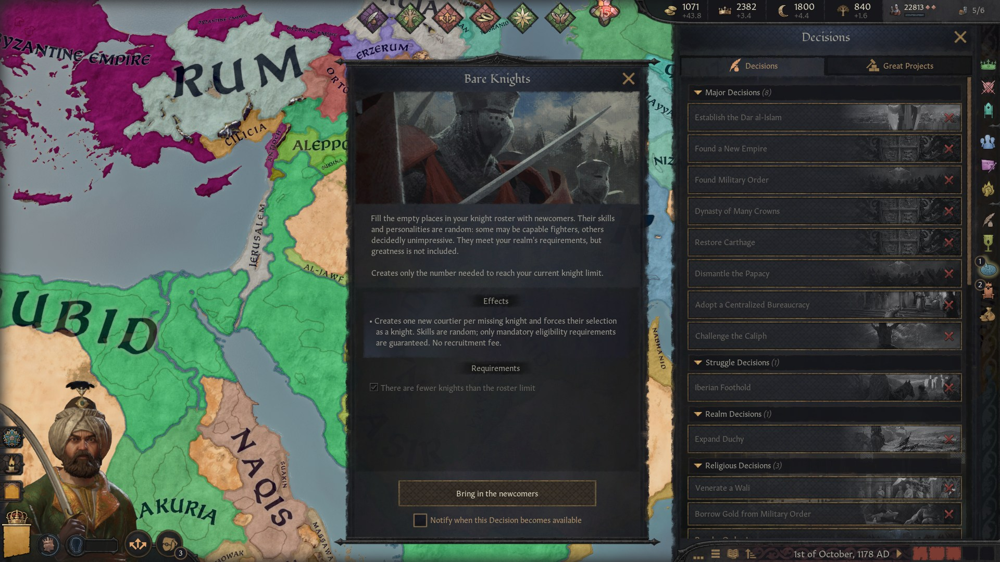

# Court Automation

## At a glance

- 🟢 **Version 0.3.0** · Targets CK3 **1.20.1.2**.
- 🟢 **Standalone:** no other mod required.
- 🟢 Fill court vacancies now, maintain court and knight rosters, or set native vacancy policies in bulk.
- 🟢 **Languages:** English, French, German, Japanese, Korean, Polish, Russian, Simplified Chinese and Spanish.
- 🟢 Optional Court Jester exclusion; conservative AI assistance enabled by default.
- 🔴 Creates characters without a recruitment fee. Court positions retain normal salaries.
- 🔴 Automatic knight recruitment clears and locks personal knight filters while enabled.
- 🔴 Covers vanilla court positions, including available DLC positions. Adventurer camp offices and mod-added positions are outside its scope.

## A court ready to serve

Fill vacancies as your realm changes, and bring in fresh faces when your court runs short.

## Fill and maintain your court

**Fill court now** and **Court Init** fill vacancies with the best eligible candidates, considering specialised positions first. Existing holders keep their jobs.

If nobody qualifies, a random courtier is created with mandatory qualifications; low aptitude is possible. Positions fill to normal capacity. Favored Minister needs an existing eligible councillor; Garuda needs an actual knight within the knight limit.

**Keep court filled** suspends native policies, fills vacancies even while paused, then checks daily, including new unlocks, dismissals and deaths. Turning it off restores each included position's previous policy, including mixed settings.

## Leave the Court Jester to you

**Exclude the Court Jester**, unchecked by default, skips the position in Court Init, Fill court now, Keep court filled and bulk policy changes. Serving jesters stay in place; manual and native appointments remain available.

Excluding it while Keep court filled is on restores its pre-automation native policy. The exclusion follows your player character through inheritance.

## Native vacancy policies

The four labelled buttons under **Advanced: native policies** select no automation, suggest candidates, appoint the best, or appoint the best and notify when nobody qualifies. Bulk changes skip excluded positions.

These policies handle vacancies without replacing holders. Turn off Keep court filled for bulk changes; an excluded jester's native policy remains independently available.

## Keep your knights filled

**Keep knights filled** recruits missing knights and checks daily. It resets minimum prowess to zero, clears house, dynasty and vassal-rank restrictions, and enables all permission checkboxes. These controls stay locked while enabled.

Random newcomers are forced to serve and may be weak. Mandatory cultural, religious and other requirements still apply. Existing individual knight statuses stay unchanged. Recruitment starts after the filter reset, even while paused.

Turning this off unlocks the filters without restoring their old values. **Bare Knights** remains a one-time recruitment decision while places are empty and no filter reset is pending.

## Plan your court budget

Salary estimates show current monthly base costs and the increase for included vacancies, by currency. An excluded jester vacancy adds nothing; an existing salary remains included. Personal discounts can change the result; paid tasks are excluded.

## Help for AI courts

A game rule enables conservative AI help: up to two missing knights and one affordable court candidate yearly. Existing eligible candidates take precedence; normal AI decides appointments. Favored Minister and Garuda are excluded.

## Getting started

1. Enable Court Automation and play a landed ruler.
2. Open **Court → Court positions → Court tools**.
3. Use **Fill court now**, enable either maintenance option, or check **Exclude the Court Jester** to handle that position separately.
4. Open **Advanced: native policies** for bulk changes while Keep court filled is off. Court Init and Bare Knights also remain in Decisions.

## Compatibility and load order

No other mod is required. Normal ruler and DLC unlocks apply.

The mod modifies `gui/window_court.gui` and `gui/window_knights.gui`. Other replacements need a compatibility patch; load order alone cannot combine them. Changed eligibility, salaries, capacities or knight rules can affect results. No general overhaul compatibility is guaranteed.

## Saves and known limits

Removing the mod does not undo characters, appointments or native settings. Turn off Keep court filled first to restore saved policies. Turning off Keep knights filled leaves filters reset.

Preferences and saved court policies follow your player character through inheritance. An error stops the affected automatic action; inspect your court before retrying.

Court filling chooses the best remaining candidate in a fixed order, not a global optimum across mutually exclusive jobs. Mandatory councillor and active-knight requirements still apply.

## Feedback and support

For a report, include your CK3 version, enabled mods, ruler culture and government, the control or decision used, and the position or knight requirement involved.

[Report an issue on GitHub](https://github.com/G4VV4KH/-CK3-Court-Automation/issues)

Email: g4vv4kh@gmail.com

### [Want to support my work? Donate on Ko-fi 💛](https://ko-fi.com/g4vv4kh)

## Find this mod elsewhere

- [Steam Workshop](https://steamcommunity.com/sharedfiles/filedetails/?id=3814028714)
- [Paradox Mods](https://mods.paradoxplaza.com/mods/162080/Any)
- [Nexus Mods](https://www.nexusmods.com/crusaderkings3/mods/408)
- [GitHub](https://github.com/G4VV4KH/-CK3-Court-Automation)

## My other mods

### Standalone mods

- [Parley: The Negotiating Table](https://steamcommunity.com/sharedfiles/filedetails/?id=3811090081) — negotiate diplomatic agreements.
- [Marriage Calculation Assistant](https://steamcommunity.com/sharedfiles/filedetails/?id=3811100163) — compare and sort marriage candidates.
- [Your Own Hegemony](https://steamcommunity.com/sharedfiles/filedetails/?id=3811201582) — found a custom hegemony.
- [Vassalization Extended](https://steamcommunity.com/sharedfiles/filedetails/?id=3813943691) — choose Forced Vassalization terms without a county limit.
- [Nomad Autorefill](https://steamcommunity.com/sharedfiles/filedetails/?id=3814793283) — automatically reinforce nomadic Men-at-Arms using herd or gold.
- [Tax Collection Automation](https://steamcommunity.com/sharedfiles/filedetails/?id=3815381275) — automatically assign tax collectors and optimize tax jurisdictions.
- [Council Assignment Automation](https://steamcommunity.com/sharedfiles/filedetails/?id=3815689627) — automate council appointments and optimize councillor assignments.
- [Strategist Assistant](https://steamcommunity.com/sharedfiles/filedetails/?id=3827659479) — plan armies, recruitment and wars.
- [Title Domination](https://steamcommunity.com/sharedfiles/filedetails/?id=3828276945) — proclaim uncreated titles through diplomacy and war.

### Compatibility patches

- [[compatch] CAA + CA](https://steamcommunity.com/sharedfiles/filedetails/?id=3816373375) — use Council Assignment Automation and Council Autopilot together.

## Credits

Mod-specific code, interface additions, translations, and publication text were generated with AI. Cover artwork was generated with AI.

Court-window integration adapts CK3 interface definitions by Paradox Interactive.

## Gallery

Authentic in-game screenshots supplied by the mod's author.

## Contributing

See [developer notes](dev.md) for implementation and verification details.
